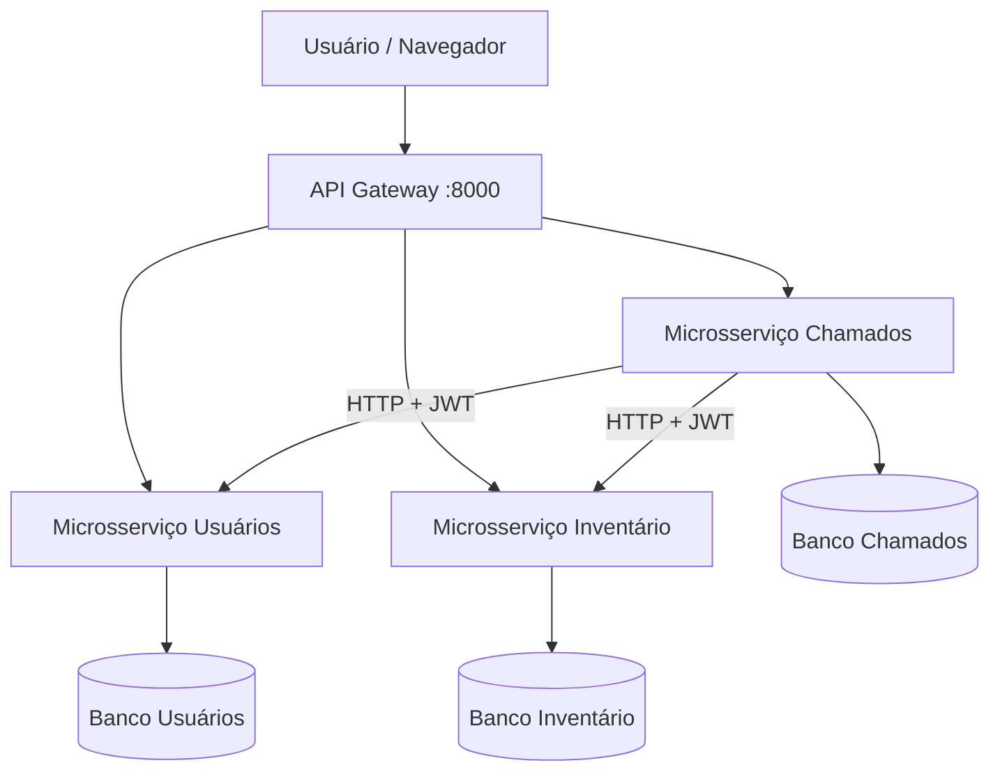

# HelpDesk TI — Arquitetura de Microsserviços

Sistema de chamados de TI desenvolvido em **Python, FastAPI e Docker**, refatorado de uma arquitetura monolítica para microsserviços independentes.

Projeto desenvolvido para a disciplina de **Arquitetura de Software**, sob orientação do Prof. Filipe Cavalcante.

## Arquitetura

O sistema possui três microsserviços independentes e um API Gateway, responsável por centralizar o acesso da aplicação.

- **Usuários:** autenticação, login, usuários e tokens JWT.
- **Inventário:** cadastro e consulta de equipamentos.
- **Chamados:** abertura, atribuição, atualização de status, comentários, SLA e notificações.
- **API Gateway:** ponto único de entrada, encaminhamento das requisições e verificação da saúde dos serviços.

### Diagrama da arquitetura



Cada microsserviço possui sua própria aplicação, banco de dados e configuração. A comunicação entre Chamados, Usuários e Inventário ocorre por HTTP, com encaminhamento do token JWT e tratamento de falhas.

## Tecnologias utilizadas

- Python 3.12
- FastAPI
- SQLAlchemy
- SQLite
- Docker e Docker Compose
- HTTPX
- JWT
- HTML, CSS e JavaScript

## Estrutura do projeto

```text
app/
├── gateway/
│   ├── Dockerfile
│   └── main.py
│
├── servicos/
│   ├── usuarios/
│   │   ├── Dockerfile
│   │   ├── requirements.txt
│   │   └── app/
│   │
│   ├── inventario/
│   │   ├── Dockerfile
│   │   ├── requirements.txt
│   │   └── app/
│   │
│   └── chamados/
│       ├── Dockerfile
│       ├── requirements.txt
│       └── app/
│
└── web/
    ├── index.html
    ├── app.js
    └── estilo.css

docker-compose.yml
.env
.env.example
README.md
```

## Como executar

### 1. Requisitos

- Docker instalado.
- Docker Compose disponível.
- Git, caso queira clonar o repositório.

### 2. Configuração

Copie o arquivo de exemplo:

```bash
cp .env.example .env
```

Configure no `.env` uma chave `JWT_SEGREDO` com pelo menos 32 caracteres.

Não compartilhe o arquivo `.env` nem envie suas chaves para o GitHub.

### 3. Iniciar o sistema

Na pasta raiz do projeto, execute:

```bash
docker compose up --build -d
```

Para verificar os containers:

```bash
docker compose ps
```

Para acompanhar os registros:

```bash
docker compose logs -f
```

Para encerrar:

```bash
docker compose down
```

Os dados ficam armazenados em volumes independentes do Docker.

## Acesso ao sistema

- **Aplicação:** http://localhost:8000
- **Documentação do Gateway:** http://localhost:8000/docs
- **Saúde dos serviços:** http://localhost:8000/saude

A porta 8000 é a única porta publicada para acesso externo. Os microsserviços e bancos de dados permanecem na rede interna do Docker.

## Contas de demonstração

As contas de demonstração são criadas quando o serviço de Usuários inicia com `DADOS_EXEMPLO=1` e o banco está vazio.

Senha padrão: `Helpdesk2026`

| E-mail | Perfil |
|---|---|
| admin@empresa.com | Administrador |
| carla@empresa.com | Técnica |
| diego@empresa.com | Técnico |
| ana@empresa.com | Solicitante |
| bruno@empresa.com | Solicitante |

Essas contas são destinadas exclusivamente a testes e demonstrações acadêmicas.

## Segurança

O sistema utiliza:

- Autenticação por e-mail e senha.
- Tokens JWT para autenticação das requisições.
- Verificação de autenticação nos serviços.
- Controle de permissões por perfil.
- Isolamento dos chamados por solicitante.
- Encaminhamento do token nas chamadas entre microsserviços.
- Timeout e tratamento de indisponibilidade com HTTP 503.
- Containers com restrições de privilégios.
- Bancos de dados separados por serviço.

## Testes realizados

Durante a execução do projeto, foram realizados os seguintes testes:

| Teste | Resultado |
|---|---|
| Inicialização dos serviços com Docker Compose | Aprovado |
| Saúde dos três microsserviços pelo Gateway | HTTP 200 |
| Login pelo Gateway | HTTP 200 |
| Acesso autenticado aos chamados | HTTP 200 |
| Acesso sem token | HTTP 401 |
| Solicitante tentando acessar chamado de outro solicitante | HTTP 404 |
| Usuários funcionando com Inventário desligado | Aprovado |
| Chamados funcionando com Inventário desligado | Aprovado |
| Abertura de chamado com ativo enquanto Inventário estava desligado | HTTP 503 |
| Recuperação do Inventário após reinicialização | Aprovado |

## Decisões arquiteturais

1. **Separação por responsabilidade:** cada microsserviço possui uma função específica.
2. **Banco de dados independente:** cada serviço possui seu próprio banco e volume.
3. **Comunicação por HTTP:** Chamados consulta Usuários e Inventário por requisições HTTP.
4. **API Gateway:** centraliza o acesso da interface e encaminha as requisições para os serviços.
5. **Resiliência:** chamadas entre serviços possuem timeout e tratamento de indisponibilidade.
6. **Notificações:** implementadas dentro do microsserviço Chamados, utilizando seu próprio banco de dados.

## Conclusão

A refatoração transformou o HelpDesk TI de uma aplicação monolítica em uma arquitetura com três microsserviços independentes e um API Gateway.

A solução permite executar, monitorar e reiniciar os serviços separadamente, mantendo a comunicação entre eles e aplicando autenticação, autorização e tratamento de falhas.

O projeto demonstra na prática os conceitos de independência, separação de responsabilidades, comunicação entre serviços e resiliência em uma arquitetura de microsserviços.