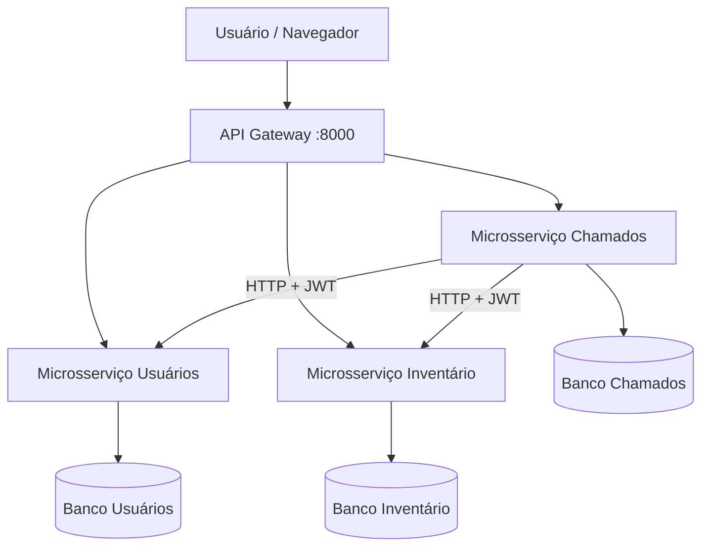

# HelpDesk TI | Plataforma de Atendimento com Microsserviços

**Vídeo de apresentação:** https://youtu.be/35tDwWoX4QQ

O **HelpDesk TI** é uma aplicação de gerenciamento de solicitações de suporte técnico, construída com **Python, FastAPI e Docker**. O projeto foi reorganizado a partir de uma estrutura monolítica para uma solução baseada em microsserviços, permitindo que cada parte do sistema funcione de maneira independente.

Desenvolvido para a disciplina de **Arquitetura de Software**, com orientação do professor Filipe Cavalcante.

## Visão geral da arquitetura

A aplicação é composta por três serviços principais e um **API Gateway**, que recebe as requisições da interface e direciona cada chamada ao serviço responsável.

- **Serviço de Usuários:** gerencia contas, autenticação, login e emissão de tokens JWT.
- **Serviço de Inventário:** realiza o registro e a consulta dos equipamentos.
- **Serviço de Chamados:** cuida da criação e atribuição de chamados, mudanças de status, comentários, SLA e notificações.
- **API Gateway:** centraliza a entrada da aplicação, encaminha as requisições e verifica a disponibilidade dos serviços.

### Representação da arquitetura



Os serviços mantêm aplicações, configurações e bancos de dados próprios. Quando o serviço de Chamados precisa consultar informações de Usuários ou do Inventário, a integração acontece por HTTP. O token JWT também é encaminhado nessas chamadas, e situações de falha são tratadas pela aplicação.

## Tecnologias e ferramentas

| Tecnologia | Utilização |
|---|---|
| Python 3.12 | Linguagem principal |
| FastAPI | Construção das APIs |
| SQLAlchemy | Integração com os bancos de dados |
| SQLite | Armazenamento dos dados |
| Docker e Docker Compose | Containerização e execução dos serviços |
| HTTPX | Comunicação HTTP entre serviços |
| JWT | Autenticação por tokens |
| HTML, CSS e JavaScript | Interface web |

## Organização dos arquivos

A estrutura principal do repositório está distribuída da seguinte maneira:

```text
app/
├── gateway/
│   ├── Dockerfile
│   └── main.py
│
├── servicos/
│   ├── usuarios/
│   │   ├── Dockerfile
│   │   ├── requirements.txt
│   │   └── app/
│   │
│   ├── inventario/
│   │   ├── Dockerfile
│   │   ├── requirements.txt
│   │   └── app/
│   │
│   └── chamados/
│       ├── Dockerfile
│       ├── requirements.txt
│       └── app/
│
└── web/
    ├── index.html
    ├── app.js
    └── estilo.css

docker-compose.yml
.env
.env.example
README.md
```

## Instalação e execução

### Pré-requisitos

Antes de iniciar, confira se o ambiente possui:

- Docker instalado;
- Docker Compose disponível;
- Git, caso vá clonar o repositório.

### Preparar as variáveis de ambiente

Na pasta principal do projeto, crie o arquivo `.env` a partir do modelo disponibilizado:

```bash
cp .env.example .env
```

Depois, abra o `.env` e defina a variável `JWT_SEGREDO` com uma chave de, no mínimo, 32 caracteres.

> **Atenção:** não publique o arquivo `.env` nem exponha suas chaves ou credenciais no GitHub.

### Subir a aplicação

Com o terminal aberto na raiz do projeto, execute:

```bash
docker compose up --build -d
```

O comando constrói as imagens necessárias e inicia os containers em segundo plano.

### Comandos úteis

Consultar os containers em execução:

```bash
docker compose ps
```

Visualizar os logs dos serviços:

```bash
docker compose logs -f
```

Parar e remover os containers:

```bash
docker compose down
```

Os dados são mantidos em volumes Docker separados, de acordo com cada serviço.

## Endereços de acesso

Depois que os containers iniciarem, utilize:

| Recurso | Endereço |
|---|---|
| Interface da aplicação | http://localhost:8000 |
| Documentação da API Gateway | http://localhost:8000/docs |
| Verificação de saúde dos serviços | http://localhost:8000/saude |

Somente a porta **8000** fica publicada para acesso externo. Os microsserviços e seus bancos de dados se comunicam pela rede interna criada pelo Docker.

## Usuários para demonstração

Quando o serviço de Usuários é iniciado com `DADOS_EXEMPLO=1` e o banco ainda não contém registros, o sistema cria contas de exemplo.

**Senha utilizada nas contas:** `Helpdesk2026`

| E-mail | Tipo de acesso |
|---|---|
| admin@empresa.com | Administrador |
| carla@empresa.com | Técnica |
| diego@empresa.com | Técnico |
| ana@empresa.com | Solicitante |
| bruno@empresa.com | Solicitante |

Esses acessos são fornecidos para fins de teste e apresentação acadêmica.

## Recursos de segurança

A aplicação adota mecanismos para controlar o acesso e proteger a comunicação entre os componentes:

- Login utilizando e-mail e senha;
- Autenticação das requisições por tokens JWT;
- Validação de autenticação nos microsserviços;
- Permissões definidas conforme o perfil do usuário;
- Restrição de visualização dos chamados ao respectivo solicitante;
- Reenvio do token JWT nas integrações entre serviços;
- Definição de timeout e resposta HTTP 503 em caso de indisponibilidade;
- Containers executados com restrições de privilégios;
- Separação dos bancos de dados por microsserviço.

## Verificações e testes

Foram executados testes para conferir a inicialização, a comunicação entre os componentes, as regras de acesso e o comportamento do sistema diante da indisponibilidade de um serviço.

| Cenário verificado | Resultado |
|---|---|
| Subida dos serviços usando Docker Compose | Aprovado |
| Consulta da saúde dos três serviços pelo Gateway | HTTP 200 |
| Realização de login pelo Gateway | HTTP 200 |
| Consulta autenticada aos chamados | HTTP 200 |
| Tentativa de acesso sem token | HTTP 401 |
| Solicitante tentando consultar chamado de outra pessoa | HTTP 404 |
| Serviço de Usuários operando com Inventário desligado | Aprovado |
| Serviço de Chamados operando com Inventário desligado | Aprovado |
| Abertura de chamado vinculado a um equipamento com Inventário indisponível | HTTP 503 |
| Retorno do Inventário após reiniciar o serviço | Aprovado |

## Principais escolhas de arquitetura

1. **Responsabilidades separadas:** cada microsserviço atende a uma parte específica do sistema.
2. **Persistência independente:** Usuários, Inventário e Chamados possuem bancos e volumes próprios.
3. **Integração via HTTP:** o serviço de Chamados consulta os serviços de Usuários e Inventário por requisições HTTP.
4. **Gateway como entrada central:** a interface acessa a aplicação pelo Gateway, que encaminha as chamadas aos destinos corretos.
5. **Tratamento de falhas:** as comunicações entre serviços utilizam timeout e respostas específicas para indisponibilidade.
6. **Notificações no serviço de Chamados:** esse recurso permanece sob responsabilidade do próprio microsserviço e utiliza seu banco de dados.

## Considerações finais

O desenvolvimento do HelpDesk TI demonstra a migração de uma aplicação monolítica para uma estrutura composta por três microsserviços independentes, integrados por um API Gateway.

Com essa organização, é possível iniciar, acompanhar e reiniciar cada serviço separadamente, sem deixar de manter a integração entre eles. A solução também aplica autenticação, controle de permissões e mecanismos para lidar com falhas de comunicação.

Dessa forma, o projeto coloca em prática conceitos importantes de arquitetura de microsserviços, como divisão de responsabilidades, independência dos componentes, comunicação entre APIs e resiliência.
